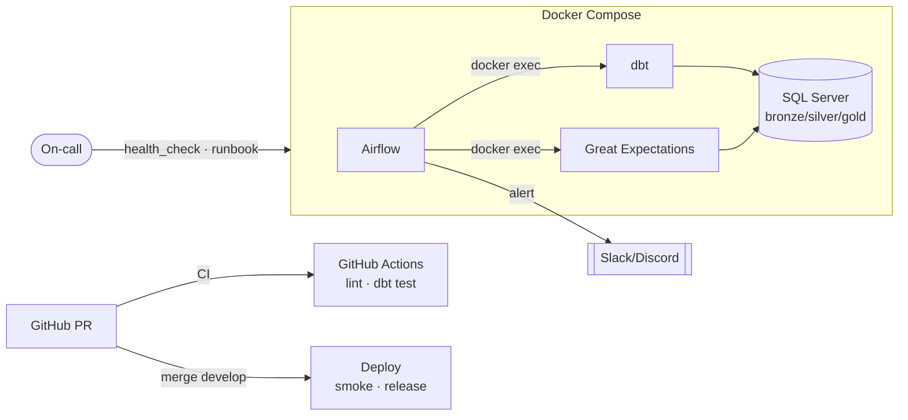

# DBT + Airflow + SQL Server — DataOps Project

Pipeline dữ liệu AdventureWorks2014 theo mô hình **Bronze → Silver → Gold** bằng dbt, được
điều phối bằng Apache Airflow và vận hành theo quy trình DataOps: Git workflow, CI/CD, kiểm thử
tự động, Data Quality (Great Expectations), monitoring/alerting và incident response.

> Hướng dẫn lab gốc (cài đặt từ đầu, giải thích dbt/Airflow) vẫn ở [`1. README.md`](1.%20README.md)
> và [`0. NEW_COMPUTER_SETUP.md`](0.%20NEW_COMPUTER_SETUP.md).

## Kiến trúc



Sơ đồ chi tiết (container, DAG, observability, CI/CD) và các quyết định thiết kế:
**[docs/architecture.md](docs/architecture.md)**.

| Thành phần | Phiên bản | Vai trò |
| --- | --- | --- |
| SQL Server | 2019 Express | Nguồn AdventureWorks2014 và đích bronze/silver/gold |
| dbt | 1.8.7 (dbt-sqlserver) | 10 models, 202 tests |
| Great Expectations | 0.18.22 | 2 suites / 40 expectations trên Silver |
| Airflow | 2.7.1, LocalExecutor, Postgres 13 | 3 DAG vận hành + 1 DAG diễn tập |

## Khởi động nhanh

```bash
export COMPOSE_PROJECT_NAME=dbt_airflow_project
export DOCKER_GID=$(stat -c '%g' /var/run/docker.sock) AIRFLOW_UID=$(id -u)   # Linux
DC="docker compose -f docker-compose.yml -f docker-compose.airflow-quality.yml"

$DC build
$DC up -d sqlserver dbt
$DC exec -T sqlserver /tmp/restore_db.sh                  # lần đầu: restore AdventureWorks2014
# lần đầu: tạo login dbt — xem "0. NEW_COMPUTER_SETUP.md" bước 2
$DC up -d --wait airflow-scheduler                        # init + webserver + ge-worker + scheduler
python3 scripts/health_check.py                           # OVERALL: OK
```

Airflow UI: <http://localhost:8080> (`admin` / `admin`, chỉ dùng cho lab).
Biến cấu hình (lịch chạy, webhook alert, email…): xem [`.env.example`](.env.example).

## Các DAG

| DAG | Lịch mặc định | Luồng |
| --- | --- | --- |
| `dbt_transform` | 06:00 giờ VN hằng ngày | `check_runtime → dbt_deps → dbt_run → dbt_test → ge_validate → dbt_docs` |
| `ge_data_quality` | mỗi 6 giờ / trigger tay | `wait_for_transform_idle → check_runtime → ge_validate → publish_quality_report` |
| `dataops_monitoring` | mỗi 30 phút | services · pipeline · metrics · disk → `publish_report` |
| `dataops_timeout_drill` | chỉ chạy tay | diễn tập task bị timeout |

Vận hành pipeline (retry, timeout, lịch, đọc log/bằng chứng): [docs/airflow_pipeline.md](docs/airflow_pipeline.md).

## Quy trình làm việc

```text
main ← develop ← feature/<tên-thành-viên>-<tuần>-<ngày>
```

- Branch từ `develop`, PR có ít nhất 1 reviewer, title theo Conventional Commits (`feat:`, `fix:`, `docs:` …).
- CI bắt buộc: `python-quality` (black/flake8/pylint), `dbt-ci` (sqlfluff, dbt run/test trên SQL Server tạm), `pr-checks`.
- Merge vào `develop` → workflow deploy kiểm chứng staging tạm, smoke test, tạo release artifact.
- Pre-commit: `pip install pre-commit && pre-commit install`.
- Unit test cho DAG utils: `python -m pytest airflow/tests -q` (không cần Airflow).

## Vận hành và sự cố

| Việc | Lệnh / tài liệu |
| --- | --- |
| Kiểm tra sức khỏe toàn hệ thống | `python3 scripts/health_check.py` (exit 0/1/2, `--json`) |
| Nhận alert | `DATAOPS_ALERT_WEBHOOK_URL` (+ `_FORMAT=slack\|discord\|teams`) trong `.env`; luôn ghi `airflow/logs/dataops_alerts/alerts.jsonl` |
| Xử lý sự cố | [docs/incident_runbook.md](docs/incident_runbook.md) |
| Báo cáo sự cố | [docs/incident_template.md](docs/incident_template.md), ví dụ [docs/incidents/](docs/incidents/) |
| Deploy / rollback | [docs/week3_deployment.md](docs/week3_deployment.md) |
| Báo cáo một DAG run | `$DC exec -T airflow-scheduler python /opt/airflow/scripts/airflow_run_report.py <dag> <run_id>` |
| Diễn tập lỗi dữ liệu | `./scripts/dq_drill.sh setup\|status\|teardown` |

## Phân công và tài liệu theo thành viên

| Thành viên | Vai trò | Module | Tài liệu |
| --- | --- | --- | --- |
| Bảo | Technical Lead / DevOps | 1 Git, 2 CI/CD, 6 Deployment | [week3_deployment.md](docs/week3_deployment.md), `.github/workflows/`, `scripts/deploy.sh` |
| Tuân | Data Engineer | 3 Testing, 5 Data Quality | [tuan_test_catalog.md](docs/tuan_test_catalog.md), [tuan_data_lineage.md](docs/tuan_data_lineage.md), `docs/tuan_*.md` |
| Thịnh | Pipeline / Observability Engineer | 4 Monitoring, 7 Incident Response | [airflow_pipeline.md](docs/airflow_pipeline.md), [incident_runbook.md](docs/incident_runbook.md), `docs/thinh_*.md` |

Bằng chứng chạy thật của từng ngày: `docs/evidence/<thành-viên>-<tuần>-<ngày>/`.

## Demo

Kịch bản demo cuối (PR → CI → CD → pipeline → monitoring → incident/recovery):
**[docs/demo_guide.md](docs/demo_guide.md)**.
