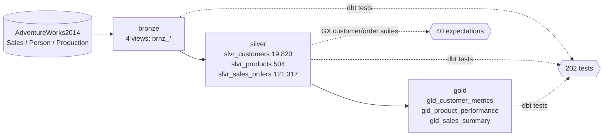
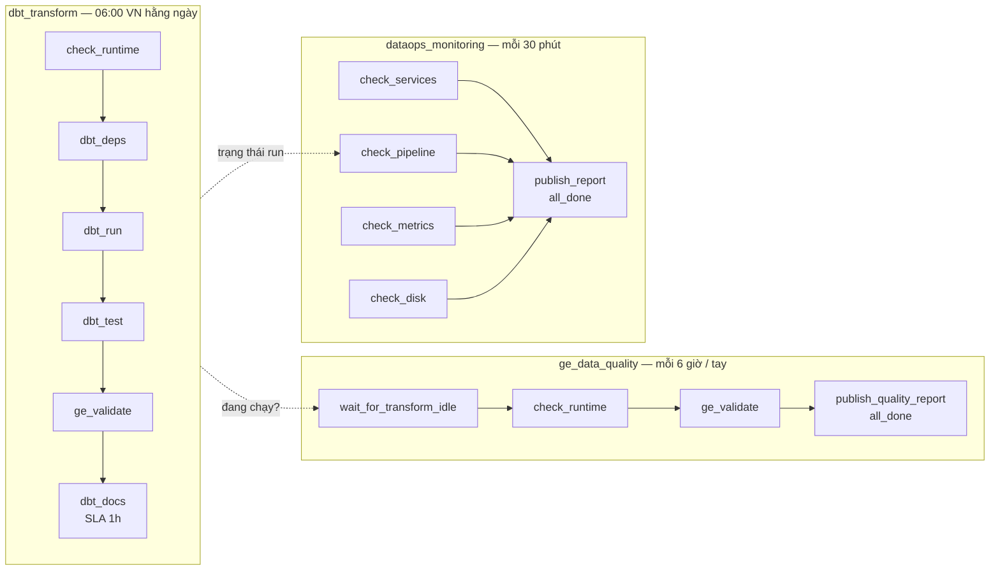
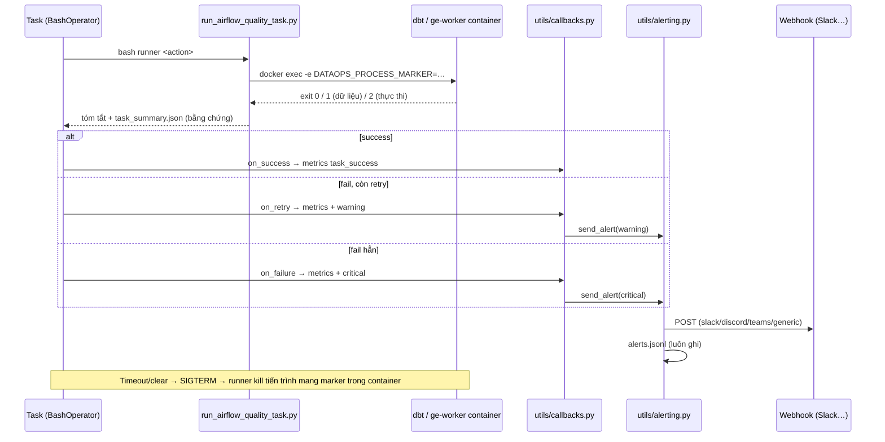
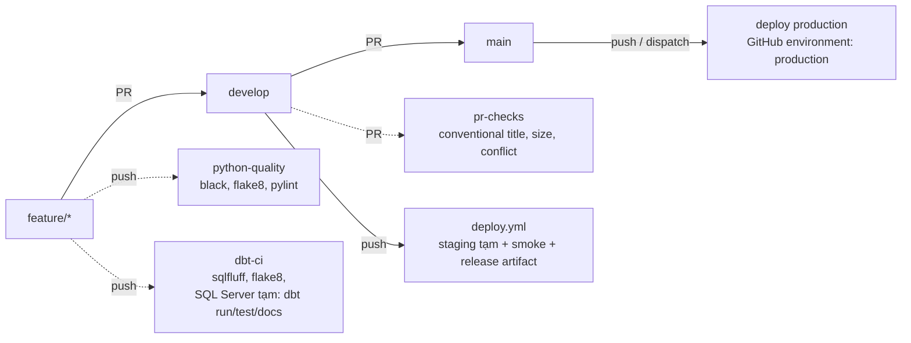

# Kiến trúc hệ thống DataOps

Tài liệu này trình bày kiến trúc của hệ thống theo năm góc nhìn: tổng quan các thành phần, luồng
dữ liệu, các DAG điều phối, luồng giám sát và quy trình CI/CD. Phần cuối tổng hợp các quyết định
thiết kế chính và lý do lựa chọn. Sơ đồ nộp bài ở dạng ảnh và PDF được đặt ngay dưới đây; các sơ đồ
chi tiết trong từng mục được viết bằng Mermaid và hiển thị trực tiếp trên GitHub.


[Tải PDF](architecture.pdf) · [Nguồn Graphviz](architecture.dot) ·
[Lineage chi tiết từng model](tuan_data_lineage.md)

Khi sơ đồ thay đổi, cả hai bản nộp được tạo lại từ gốc repository:

```bash
dot -Tpng docs/architecture.dot -o docs/architecture.png
dot -Tpdf docs/architecture.dot -o docs/architecture.pdf
```

## 1. Tổng quan


Hệ thống chạy trên Docker Compose với sáu service. SQL Server chứa cả dữ liệu nguồn
AdventureWorks2014 lẫn các schema bronze, silver, gold do dbt tạo ra. Postgres chỉ lưu metadata
của Airflow (trạng thái các lần chạy, task, người dùng), không chứa dữ liệu nghiệp vụ.

Airflow không cài dbt hay Great Expectations (GX) bên trong. Mỗi task gọi script
`run_airflow_quality_task.py`, script này thực thi lệnh trong container `dbt` hoặc `ge-worker`
bằng `docker exec`. Thay đổi mã nguồn đi qua GitHub: pull request kích hoạt CI, merge vào
`develop` hoặc `main` kích hoạt workflow triển khai. Khi có sự cố, Airflow gửi cảnh báo tới kênh
chat, người trực dùng `health_check.py` và runbook để chẩn đoán và khôi phục.

| Lớp | Thành phần | Phụ trách |
| --- | --- | --- |
| Quản lý mã nguồn, CI/CD, triển khai, rollback | `.github/workflows/*`, `scripts/deploy.sh`, `rollback.sh`, `smoke_tests.py` | Bảo |
| Biến đổi dữ liệu và chất lượng dữ liệu | `dbt/models`, `dbt/tests`, `great_expectations/`, runner | Tuân |
| Điều phối, giám sát, xử lý sự cố | `airflow/dags`, `airflow/dags/utils/`, `health_check.py`, runbook | Thịnh |

## 2. Luồng dữ liệu: Bronze → Silver → Gold



Sáu bảng nguồn thuộc các schema `Sales`, `Person` và `Production` của AdventureWorks2014 đi qua
**4 Bronze view → 3 Silver table → 3 Gold table** bằng `source()` và `ref()` của dbt. Các model
được tạo lại trong cùng SQL Server, không chuyển dữ liệu sang PostgreSQL. Mỗi lớp có một vai trò
riêng:

- **Bronze** gồm 4 view đọc trực tiếp từ các bảng nguồn Sales, Person, Production, chọn các cột
  cần dùng, ghép các bảng liên quan và đặt lại tên cột. Lớp này chưa làm sạch dữ liệu và không lưu
  dữ liệu riêng, nên luôn phản ánh đúng dữ liệu nguồn. `brnz_example` là view minh họa chỉ đọc
  `Sales.Customer` và không có model nào phía sau.
- **Silver** gồm 3 bảng đã làm sạch và chuẩn hóa: khách hàng, sản phẩm, dòng đơn hàng. Đây là lớp
  được kiểm tra chất lượng kỹ nhất.
- **Gold** gồm 3 bảng tổng hợp phục vụ phân tích. Số dòng của `gld_customer_metrics` và
  `gld_product_performance` bằng đúng số khách hàng và sản phẩm ở Silver (mỗi đối tượng một dòng),
  còn `gld_sales_summary` là bảng gộp nên ít dòng hơn nhiều.

Chất lượng dữ liệu được bảo vệ bởi hai lớp kiểm tra: 202 dbt test trên cả ba lớp (định nghĩa
trong `dbt/models/*/schema.yml` và `dbt/tests/`) và 40 expectation GX trên Silver (định nghĩa
trong `great_expectations/expectations/`).

## 3. Các DAG điều phối



Ba DAG vận hành bổ sung cho nhau:

| DAG | Mục đích | Hành vi khi có lỗi |
| --- | --- | --- |
| `dbt_transform` | Pipeline chính: build dữ liệu, chạy test, kiểm tra GX như cổng chặn, rồi sinh tài liệu | Lỗi tạm thời được retry với thời gian chờ tăng dần; gửi cảnh báo warning khi retry và critical khi thất bại hẳn |
| `ge_data_quality` | Kiểm tra lại dữ liệu Silver giữa các lần build | Gửi một cảnh báo critical kèm số expectation đạt và không đạt |
| `dataops_monitoring` | Giám sát sức khỏe tổng thể của hệ thống | Gửi cảnh báo khi trạng thái thay đổi, nhắc lại sau 6 giờ nếu sự cố kéo dài, báo khi phục hồi |
| `dataops_timeout_drill` | Diễn tập tình huống task bị treo, chỉ chạy tay | Xác nhận runner dừng được tiến trình trong container |

Các DAG có liên hệ với nhau qua hai đường nét đứt trên sơ đồ: `ge_data_quality` chờ cho đến khi
`dbt_transform` không còn chạy để tránh kiểm tra đúng lúc bảng đang được ghi lại, còn
`dataops_monitoring` đọc trạng thái lần chạy gần nhất của `dbt_transform` để phát hiện pipeline
thất bại hoặc không chạy theo lịch. Thiết kế chi tiết của từng DAG nằm trong
[airflow_pipeline.md](airflow_pipeline.md).

## 4. Luồng giám sát



Sơ đồ trên mô tả điều xảy ra trong một lần chạy task. Runner thực thi lệnh trong container và trả
về một trong ba exit code: 0 là thành công, 1 là dữ liệu không đạt, 2 là lỗi thực thi. Toàn bộ
output chi tiết của dbt/GX được ghi vào thư mục bằng chứng riêng, log của Airflow chỉ nhận một dòng
tóm tắt để không làm lộ dữ liệu hay thông tin kết nối.

Khi task kết thúc, Airflow tự gọi callback tương ứng với kết quả. Callback ghi metrics và, nếu task
thất bại, gửi cảnh báo qua module alerting. Cảnh báo luôn được ghi vào file log, đồng thời gửi tới
webhook nếu đã cấu hình. Nếu task bị hủy giữa chừng, runner dừng đúng các tiến trình mà nó đã khởi
chạy trong container, nhận diện bằng một mã định danh riêng cho mỗi lần chạy.

Các tín hiệu giám sát được lưu ở những vị trí sau:

| Tín hiệu | Nơi lưu | Được sử dụng bởi |
| --- | --- | --- |
| Task log và dòng `DATAOPS_EVENT` | `airflow/logs/dag_id=…/run_id=…/task_id=…/attempt=N.log` | Airflow UI |
| Bằng chứng chi tiết của dbt/GX | `great_expectations/uncommitted/airflow/<hash>/<task>/try-N-<uuid>/` | Điều tra sự cố |
| Metrics | `airflow/logs/dataops_metrics/task_metrics.jsonl` | Monitoring DAG, health check |
| Cảnh báo | `airflow/logs/dataops_alerts/alerts.jsonl` và webhook/email | Người trực, health check |
| Trạng thái sức khỏe | `airflow/logs/dataops_monitoring/latest.json`, `history.jsonl` | Health check, chống gửi cảnh báo lặp |
| Trạng thái các lần chạy | Metadata DB của Airflow (Postgres) | Airflow UI, monitoring DAG |

## 5. Quy trình CI/CD



Mã nguồn đi theo luồng `feature/*` → `develop` → `main`. Mỗi lần push lên nhánh feature, CI kiểm
tra chất lượng mã Python và SQL, rồi chạy thử dbt trên một SQL Server tạm. Pull request được kiểm
tra thêm về định dạng tiêu đề, kích thước và xung đột. Khi merge vào `develop`, workflow triển khai
dựng một môi trường staging tạm, chạy dbt và smoke test, rồi lưu release đã được kiểm chứng. Merge
vào `main` triển khai lên môi trường production. Nếu một bản triển khai có lỗi, `rollback.sh` khôi
phục release trước đó. Mã nguồn liên quan: `.github/workflows/deploy.yml`, `scripts/deploy.sh`,
`scripts/rollback.sh`, `scripts/smoke_tests.py`.

## 6. Quyết định thiết kế chính

| Quyết định | Lý do |
| --- | --- |
| dbt và GX chạy trong container riêng, Airflow gọi bằng `docker exec` | Giữ nguyên các thư viện của image Airflow chính thức; mỗi công cụ được cố định phiên bản riêng, không xung đột với nhau |
| Runner phân biệt exit code 1 (dữ liệu) và 2 (thực thi) | Tách lỗi cần sửa dữ liệu khỏi lỗi hạ tầng; lỗi dữ liệu của GX không được retry vì chạy lại vẫn cho cùng kết quả |
| `check_runtime` chạy trước mọi bước | Lỗi hạ tầng được phát hiện sớm với thông báo rõ ràng, trước khi pipeline chạm vào dữ liệu |
| Cảnh báo qua callback kết hợp với monitoring độc lập | Callback báo lỗi của từng lần chạy; monitoring phát hiện cả khi không có lần chạy nào (service hoặc scheduler ngừng hoạt động) |
| Monitoring chỉ cảnh báo khi trạng thái thay đổi | Mỗi sự cố tạo ra một thông báo thay vì thông báo lặp lại; người trực được báo khi hệ thống phục hồi |
| Code giám sát chỉ dùng thư viện chuẩn và không bao giờ ném lỗi | Không thêm phụ thuộc vào image; lỗi trong phần giám sát không làm hỏng pipeline |
| `catchup=False`, `max_active_runs=1` | Dữ liệu là dữ liệu lịch sử nên không cần chạy bù; hai lần chạy cùng ghi vào một bảng dbt là không an toàn |

## 7. Phạm vi và ranh giới

Docker Compose gốc cung cấp các service `sqlserver`, `postgres`, `airflow-webserver`,
`airflow-scheduler` và `dbt`; file overlay `docker-compose.airflow-quality.yml` bổ sung
`ge-worker` và `airflow-init`. Cổng trên máy host được khai báo trong Compose gốc: SQL Server
`1433`, Airflow `8080`. PostgreSQL không lưu dữ liệu nghiệp vụ.

`dbt_transform` ở trạng thái tạm dừng khi mới triển khai và có lịch mặc định 06:00 hằng ngày khi
được bật. DAG không dùng source freshness làm cổng chặn, vì dữ liệu mẫu AdventureWorks là dữ liệu
lịch sử và luôn vượt ngưỡng freshness 24/48 giờ.

Workflow staging tạo SQL Server tạm trên runner của GitHub Actions và hủy sau khi job kết thúc.
Workflow production chỉ chạy từ `main`, dùng secrets của GitHub environment và cần một database
production thực sự được cung cấp.

Các sơ đồ thể hiện luồng logic; số lượng model, nguồn và lịch chạy cần được đối chiếu lại khi code
thay đổi.
