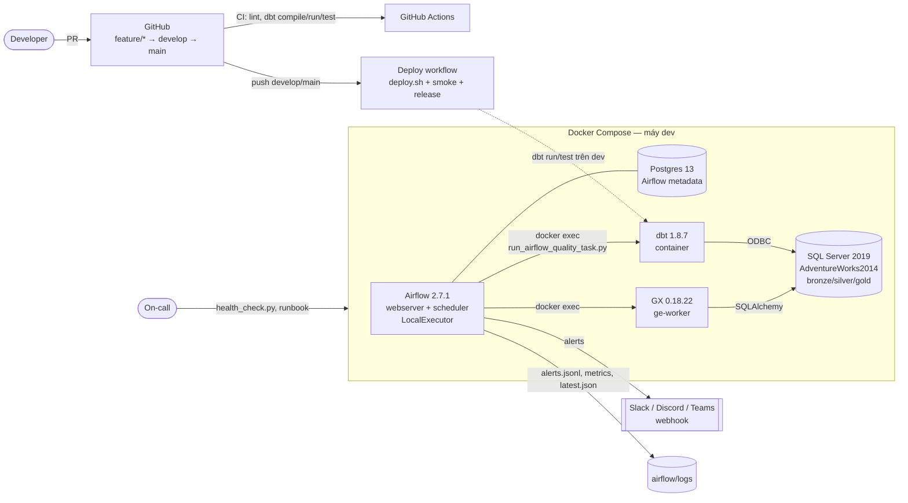
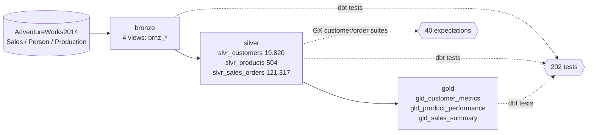
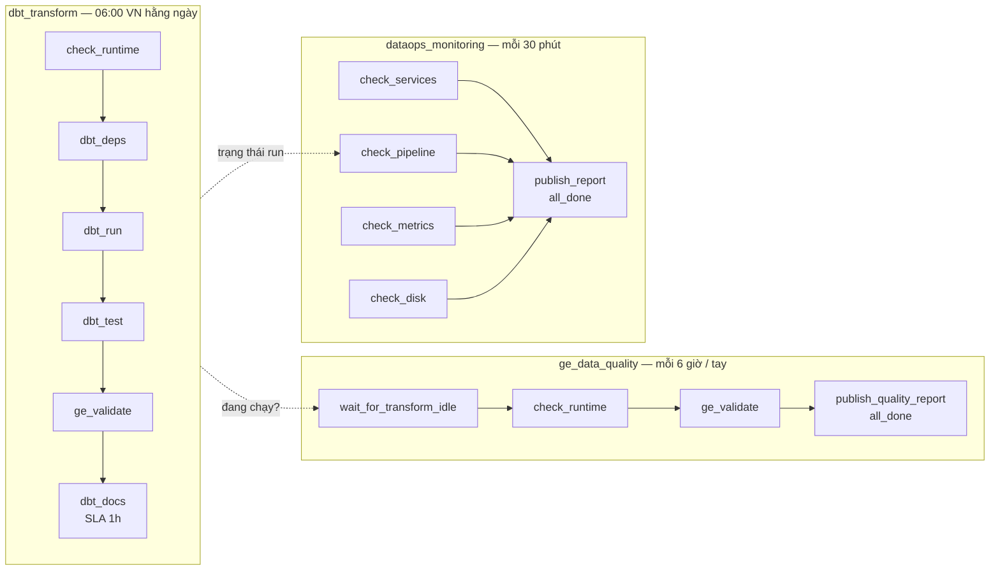
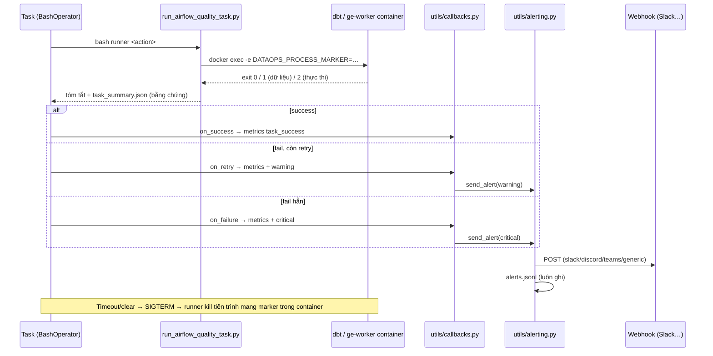
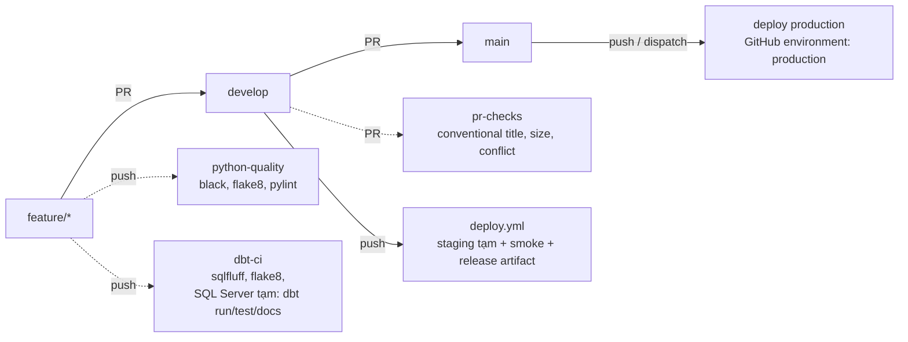

# Kiến trúc hệ thống DataOps

Sơ đồ dùng Mermaid (GitHub hiển thị trực tiếp). Mỗi phần ghi người phụ trách chính.

## 1. Tổng quan

| Lớp | Thành phần | Phụ trách |
| --- | --- | --- |
| Source control, CI/CD, deploy, rollback | `.github/workflows/*`, `scripts/deploy.sh`, `rollback.sh`, `smoke_tests.py` | Bảo |
| Transform + chất lượng dữ liệu | `dbt/models`, `dbt/tests`, `great_expectations/`, runner | Tuân |
| Orchestration, monitoring, incident | `airflow/dags`, `utils/`, `health_check.py`, runbook | Thịnh |

## 2. Dữ liệu: Bronze → Silver → Gold

Chi tiết lineage và catalog test: [tuan_data_lineage.md](tuan_data_lineage.md), [tuan_test_catalog.md](tuan_test_catalog.md).

## 3. Các DAG

| DAG | Mục đích | Khi fail |
| --- | --- | --- |
| `dbt_transform` | build + test + GX gate + docs | retry backoff; alert warning/critical |
| `ge_data_quality` | re-validate Silver giữa các lần build | alert critical có số expectation đạt/không đạt |
| `dataops_monitoring` | sức khỏe tổng thể | alert khi trạng thái đổi, nhắc lại sau 6 h, báo phục hồi |
| `dataops_timeout_drill` | diễn tập timeout (tay) | xác nhận runner dọn tiến trình |

## 4. Luồng observability

| Tín hiệu | Nơi lưu | Đọc bằng |
| --- | --- | --- |
| Task log + `DATAOPS_EVENT` | `airflow/logs/dag_id=…/run_id=…/task_id=…/attempt=N.log` | Airflow UI, `grep` |
| Bằng chứng dbt/GX | `great_expectations/uncommitted/airflow/<hash>/<task>/try-N-<uuid>/` | `task_summary.json`, `stdout.log` |
| Metrics | `airflow/logs/dataops_metrics/task_metrics.jsonl` | `summarize_metrics`, monitor |
| Alert | `airflow/logs/dataops_alerts/alerts.jsonl` + webhook/email | chat, health check |
| Trạng thái sức khỏe | `airflow/logs/dataops_monitoring/latest.json`, `history.jsonl` | health check, runbook |
| Báo cáo run | `scripts/airflow_run_report.py` | JSON cho bằng chứng |

## 5. CI/CD (Bảo)

Chi tiết deploy/rollback: [week3_deployment.md](week3_deployment.md).

## 6. Quyết định thiết kế chính

| Quyết định | Lý do |
| --- | --- |
| dbt và GX chạy trong container riêng, Airflow gọi bằng `docker exec` | giữ nguyên dependency graph của image Airflow chính thức; mỗi công cụ pin version riêng (Tuân) |
| Runner trả exit 1 = dữ liệu, 2 = thực thi | phân biệt lỗi cần sửa dữ liệu với lỗi hạ tầng; GX exit 1 không retry |
| `check_runtime` trước mọi bước | lỗi hạ tầng được báo rõ ràng và không chạm vào dữ liệu |
| Alert qua callback + monitor độc lập | callback báo lỗi của từng run; monitor phát hiện cả khi không có run nào chạy (service chết, scheduler dừng) |
| Monitor chỉ alert khi trạng thái đổi | một sự cố = một thông báo; có thông báo phục hồi |
| Mọi thứ observability dùng thư viện chuẩn, không bao giờ raise | không thêm dependency vào image; lỗi giám sát không làm hỏng pipeline |
| `catchup=False`, `max_active_runs=1` | dataset lịch sử; hai run cùng ghi bảng dbt là không an toàn |
