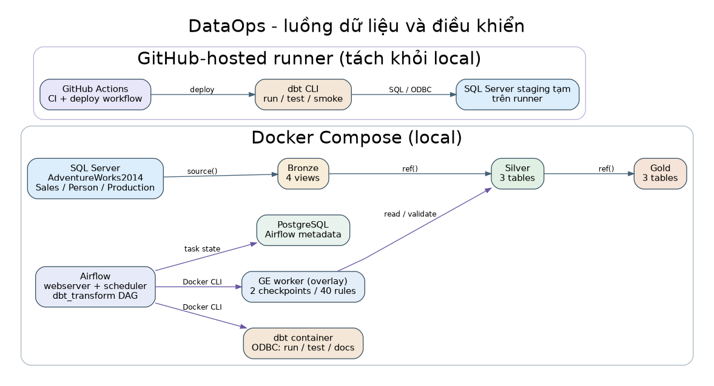

# Kiến trúc hệ thống



[Tải PDF](architecture.pdf) · [Nguồn Graphviz](architecture.dot) ·
[Lineage chi tiết từng model](tuan_data_lineage.md)

Khi thay đổi sơ đồ, tạo lại cả hai bản nộp từ gốc repository:

```bash
dot -Tpng docs/architecture.dot -o docs/architecture.png
dot -Tpdf docs/architecture.dot -o docs/architecture.pdf
```

## Luồng dữ liệu

AdventureWorks2014 nằm trong SQL Server. Sáu bảng đang được dùng thuộc các
schema `Sales`, `Person` và `Production`; chúng đi qua **4 Bronze views → 3
Silver tables → 3 Gold tables** bằng `source()` và `ref()` của dbt. Các models
được tạo lại trong cùng SQL Server, không chuyển dữ liệu sang PostgreSQL.
`brnz_example` là view minh họa chỉ dùng `Sales.Customer`, không có downstream.
Danh sách cạnh nguồn/model chính xác nằm ở [lineage](tuan_data_lineage.md).

## Luồng điều khiển

- Airflow webserver cung cấp UI ở `localhost:8080`; scheduler thực thi DAG
  `dbt_transform`. DAG đi theo `dbt_deps → dbt_run → dbt_test → ge_validate →
  dbt_docs`. Nó dùng Docker CLI/socket để gọi dbt container và `ge-worker`.
  `ge-worker` chỉ có khi chạy cùng
  [`docker-compose.airflow-quality.yml`](../docker-compose.airflow-quality.yml).
- Hai GE checkpoints kiểm tra bảng `silver.slvr_customers` và
  `silver.slvr_sales_orders`; chúng không tạo models. PostgreSQL chỉ lưu
  metadata của Airflow. Các output dbt/GX và task evidence nằm trong bind
  mounts; xem [hướng dẫn tích hợp](tuan_week3_day11_12.md).
- `dbt_transform` mặc định paused và chưa bật lịch. Nó không chạy source
  freshness như một gate, vì dữ liệu mẫu lịch sử đã vượt SLA 24/48 giờ.
- GitHub Actions kiểm tra PR và chạy workflow deploy riêng trên runner. Push
  vào `develop` tạo SQL Server staging tạm để kiểm thử; database bị hủy sau
  job. Workflow production chỉ chạy từ `main` với GitHub environment secrets
  và cần database production thực sự được cung cấp.

## Phạm vi và ranh giới

Docker Compose cung cấp các service `sqlserver`, `postgres`, `airflow-webserver`,
`airflow-scheduler`, `dbt`; overlay thêm `ge-worker` và `airflow-init`. Port
host được khai báo ở Compose gốc: SQL Server `1433`, Airflow `8080`.
PostgreSQL không xuất dữ liệu nghiệp vụ. Sơ đồ thể hiện luồng logic; số lượng
models/nguồn và lịch chạy phải được đối chiếu lại khi thay đổi code.
