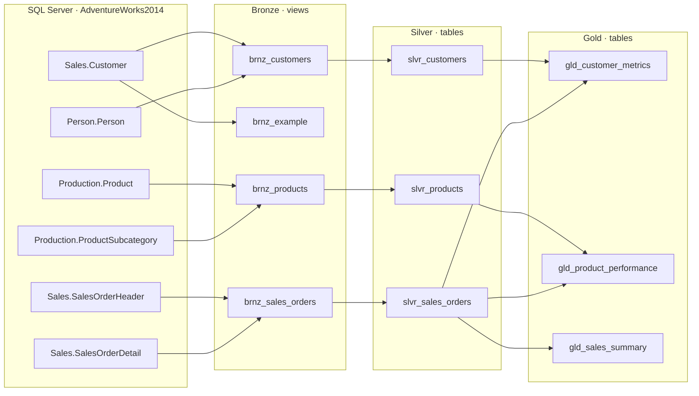

# Data lineage — nguồn, models và chỉ số

Rà soát ngày **18/11/2026** cho nhiệm vụ ngày 14 của Tuân, trên code sau PR #14. Sơ đồ có **6 nguồn đang dùng, 10 models và 15 quan hệ phụ thuộc trực tiếp**. Quan hệ được đối chiếu với `source()`/`ref()` trong SQL và manifest của lượt nghiệm thu ngày 13; [inventory JSON](evidence/tuan-week3-day14/20261118/lineage_inventory.json) lưu IDs, relations và hashes để truy vết.

## Luồng dữ liệu

Mỗi mũi tên là đầu vào dữ liệu của model, không phải quan hệ khóa ngoại hoặc thứ tự task Airflow.

`brnz_example` là nhánh minh họa lấy từ Customer, không có model downstream. Bảy khai báo `raw` trong schema `dbo` không được models sử dụng nên không đưa vào đồ thị hoạt động. Đặc biệt, **Production.ProductCategory không phải nguồn đang được đọc**: `category_id` hiện lấy từ cột `ProductCategoryID` của ProductSubcategory. Không vẽ thêm cạnh từ dimension customer/product sang Silver sales chỉ vì có relationships tests.

## Grain, joins và bộ lọc

Relations bên dưới dùng target `dev` trong bằng chứng ngày 13, database `AdventureWorks2014`; schema vật lý có thể khác với target khác. [Manifest inventory](evidence/tuan-week3-day14/20261118/lineage_inventory.json) ghi đầy đủ database/schema/alias. Bronze là view đọc dữ liệu nguồn khi truy vấn; Silver/Gold là table tạo lại bởi dbt, không phải mô hình incremental hay lưu lịch sử thay đổi.

| Model / SQL | Grain và đầu vào | Biến đổi cần giữ đúng |
| --- | --- | --- |
| [bronze.brnz_customers](../dbt/models/bronze/brnz_customers.sql) | Một dòng/`CustomerID`; Customer LEFT JOIN Person bằng `PersonID = BusinessEntityID` | Giữ khách hàng cửa hàng không có Person; tên/email preference có thể NULL. `last_modified_date` lấy từ **Customer.ModifiedDate**, không phải Person.ModifiedDate. |
| [bronze.brnz_example](../dbt/models/bronze/brnz_example.sql) | Một dòng/`id = CustomerID`, từ Customer | `name = AccountNumber`; cả `created_at` và `updated_at` lấy ModifiedDate, không phải ngày tạo thật. |
| [bronze.brnz_products](../dbt/models/bronze/brnz_products.sql) | Một dòng/`ProductID`; Product LEFT JOIN ProductSubcategory bằng `ProductSubcategoryID` | Giữ sản phẩm thiếu subcategory; `last_modified_date` lấy Product.ModifiedDate. |
| [bronze.brnz_sales_orders](../dbt/models/bronze/brnz_sales_orders.sql) | Dòng hàng `(sales_order_id, order_detail_id)`; Header LEFT JOIN Detail bằng SalesOrderID | Header cung cấp ngày/trạng thái/customer/channel; Detail cung cấp product/quantity/price/discount/LineTotal. Header không có detail tạo dòng detail NULL; tests bắt buộc khóa sẽ phát hiện. |
| [silver.slvr_customers](../dbt/models/silver/slvr_customers.sql) | Một dòng/`customer_id`, giữ tập khóa Bronze | Chỉ thay tên NULL bằng `Unknown`, ghép bằng dấu cách; không trim/chuẩn hóa hoa thường. Email/store/territory giữ NULL hợp lệ. |
| [silver.slvr_products](../dbt/models/silver/slvr_products.sql) | Một dòng/`product_id`, giữ tập khóa Bronze | Color/Size NULL → `N/A`; Weight NULL → 0; SubcategoryName NULL → `Uncategorized`; `is_discontinued` theo DiscontinuedDate có NULL hay không. Weight không được đổi đơn vị. |
| [silver.slvr_sales_orders](../dbt/models/silver/slvr_sales_orders.sql) | Một dòng/khóa ghép order/detail đủ điều kiện | Chỉ giữ `order_qty > 0 AND unit_price >= 0`; NULL bị loại. Suy ra channel, gross amount, effective unit price và discount flag. |
| [gold.gld_customer_metrics](../dbt/models/gold/gld_customer_metrics.sql) | Một dòng/`customer_id`; Silver customers LEFT JOIN sales | Giữ khách chưa mua: count = 0; doanh thu, AOV, số lượng và ngày giao dịch NULL. |
| [gold.gld_product_performance](../dbt/models/gold/gld_product_performance.sql) | Một dòng/`product_id`; Silver products LEFT JOIN sales | Giữ sản phẩm chưa bán: count/margin = 0; quantity/revenue/average price/profit NULL. |
| [gold.gld_sales_summary](../dbt/models/gold/gld_sales_summary.sql) | Một dòng/`CAST(order_date AS date)` trong Silver sales | Chỉ có ngày có sales; không tự điền các ngày thiếu bằng 0. |

Grain customer/product phụ thuộc tính duy nhất của khóa dimension và khóa join phía nguồn. LEFT JOIN không tự ngăn dữ liệu bị nhân bản nếu khóa phía phải trùng; `unique`, khóa ghép và đối chiếu là các kiểm tra riêng. Gold group theo khóa cùng thuộc tính mô tả hiện tại; project không có SCD để khôi phục tên, territory hoặc giá vốn tại thời điểm giao dịch.

## Truy vết cột và công thức quan trọng

Bảng này được đọc và đối chiếu thủ công với SQL; đồ thị manifest tự động chỉ ở cấp model/source, **không phải công cụ lineage toàn bộ 131 cột**. Mô tả đầy đủ từng cột nằm trong schema YAML và [dbt docs](tuan_week3_dbt_docs.md).

| Đầu ra | Nguồn và đường đi | Công thức / ý nghĩa |
| --- | --- | --- |
| Customer key và tên | Customer.CustomerID + Person.FirstName/LastName → Bronze customers → Silver customers → Gold customer | Gold key từ dimension; sales.customer_id lại lấy Header.CustomerID. Relationships tests kiểm tra mối liên hệ hai đường này. |
| Product key, category và subcategory | Product.ProductID → Bronze/Silver products → Gold product; ProductSubcategory.ProductCategoryID → Bronze/Silver products; ProductSubcategory.Name → Bronze/Silver products → Gold product | `category_id` dừng ở Silver, không xuất hiện trong Gold. Gold có `product_id` và `subcategory_name`; không join bảng ProductCategory. |
| Silver `line_total` | SalesOrderDetail.LineTotal → Bronze sales → Silver sales | Giữ giá trị nguồn; test độc lập đối chiếu `OrderQty × UnitPrice × (1 − UnitPriceDiscount)`. Chưa gồm tax/freight. |
| Silver `gross_amount`, `effective_unit_price` | Detail.UnitPrice/OrderQty/LineTotal qua Bronze | `unit_price × order_qty`; `line_total / NULLIF(order_qty, 0)`. |
| Silver `order_channel`, `has_discount` | Header.OnlineOrderFlag và Detail.UnitPriceDiscount | Flag = 1 → Online, còn lại Offline; discount > 0 → 1, còn lại 0. Domain tests phát hiện đầu vào ngoài miền. |
| Gold `total_orders` | Header.SalesOrderID → Bronze/Silver sales | `COUNT(DISTINCT sales_order_id)` trong từng customer/product/ngày; không phải số dòng hàng. |
| Gold revenue và quantity | Detail.LineTotal/OrderQty → Bronze/Silver sales | `SUM(line_total)` và `SUM(order_qty)` theo grain Gold; mỗi bảng là một cách tổng hợp của cùng sales. |
| Customer AOV và ngày mua | Silver sales.line_total/sales_order_id/order_date | Doanh thu / số đơn phân biệt; MIN/MAX order_date. `orders_with_discount` đếm đơn có ít nhất một dòng giảm giá. |
| Product `avg_selling_price` | Detail.UnitPrice → Bronze/Silver sales | `AVG(unit_price)` theo **dòng hàng**, trước discount, không gia quyền quantity. |
| Product profit và margin | Product.StandardCost → Bronze/Silver product; revenue/quantity từ sales | `revenue − quantity × standard_cost hiện tại`; chia revenue × 100 nếu có bán. Có bán nhưng revenue = 0 → margin NULL; profit âm hợp lệ. |
| Daily average, channels, discount | Header.OrderDate/OnlineOrderFlag + Detail.LineTotal/Discount → Silver sales | `AVG(line_total)` là trung bình dòng; kênh đếm đơn phân biệt; discounted revenue cộng **doanh thu ròng của dòng giảm giá**, không phải số tiền được giảm. |

Customer AOV khác daily average line value. Không cộng số đơn của từng sản phẩm để suy ra số đơn toàn kỳ; không cộng số khách phân biệt từng ngày thành số khách phân biệt toàn kỳ. Trong bằng chứng ngày 13 có 121.317 dòng hàng nhưng chỉ 31.465 đơn, tổng doanh thu `109846381.399888` và quantity 274.914; xem [đối chiếu](evidence/tuan-week3-day13/20261117/layer_reconciliation.json).

## Khi một nguồn thay đổi

| Nguồn/cột thay đổi | Nhánh model cần xem trước |
| --- | --- |
| Sales.Customer | Bronze/Silver customers → Gold customer, cùng nhánh brnz_example |
| Person.Person | Bronze/Silver customers → Gold customer; không đổi watermark Customer.ModifiedDate một cách tự động |
| Product hoặc ProductSubcategory | Bronze/Silver products → Gold product; StandardCost tác động profit/margin hiện tại |
| SalesOrderHeader hoặc SalesOrderDetail | Bronze/Silver sales → cả ba models Gold |

Đây là ảnh hưởng theo dependency model. Relationships tests có thể bị ảnh hưởng ở nhánh khác dù không có cạnh dữ liệu; kiểm tra danh sách test được chọn trước khi chạy. Phần grain/công thức là hợp đồng hiện tại của project, không tự khẳng định đúng với mọi yêu cầu nghiệp vụ tương lai.

## Thứ tự xử lý và điểm kiểm tra

Airflow thực thi theo thứ tự **`dbt_deps → dbt_run → dbt_test → ge_validate → dbt_docs`**. Bên trong `dbt_run`, dbt dùng đồ thị dependency để build models; không có nghĩa mười models là mười Airflow tasks. GE chỉ đọc Silver customer/order, không tạo thêm model hoặc biến đổi dữ liệu. Lỗi tests/GE chặn downstream docs. Xem [tích hợp Airflow](tuan_week3_day11_12.md) và [danh mục tests](tuan_test_catalog.md).

Freshness là kiểm tra riêng trên sáu nguồn, dùng business `ModifiedDate` so với UTC, không phải lúc restore/ingest. DAG hiện không chạy freshness; `DQ-W2-01` vẫn mở với dữ liệu lịch sử. Metadata nguồn, relation names và đồ thị không chứng minh ingestion/scheduler SLA đã đạt. Ngày 14 không chạy lại pipeline hoặc đóng phát hiện này.
