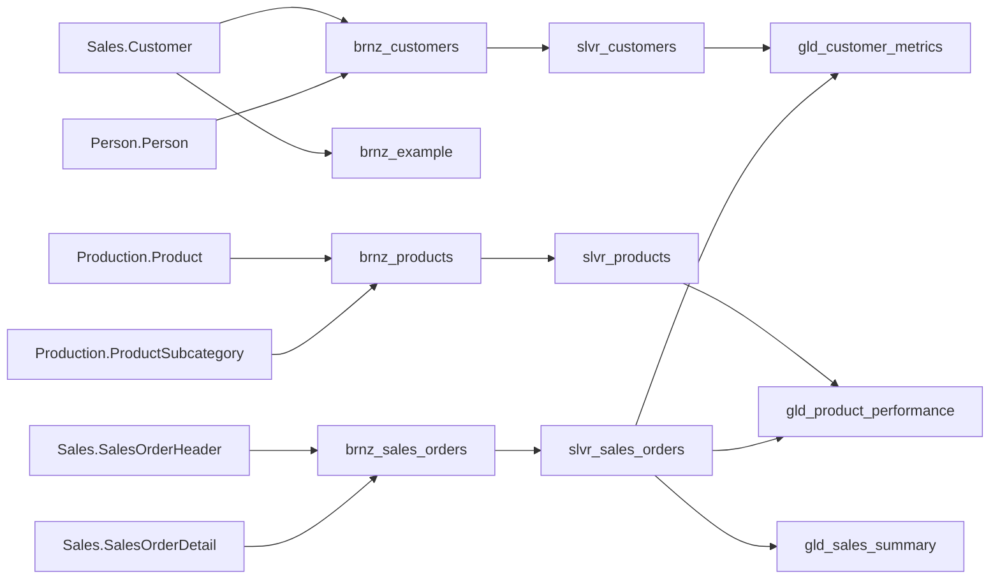

# Tuân — Review models ngày 1–2, tuần 1

Ngày review: **06/11/2026** (Asia/Saigon). Phạm vi theo `Project-Devops.md:54`: kiểm tra `dbt debug`, `dbt run`, `dbt test` và các models.

Tài liệu này ghi **review tĩnh** SQL/YAML/config đang có trong repository ngày 06/11. Kết quả chạy thực tế ngày 07/11, số dòng, schema vật lý và các KPI đã đối chiếu nằm trong [báo cáo thực thi ngày 1–2](tuan_week1_day1_2.md). Không sử dụng `target/`, `logs/` cũ để kết luận pipeline hiện đang chạy thành công. Chưa sửa SQL/schema và chưa triển khai các tests thuộc ngày 3–4.

## 1. Luồng dữ liệu và phạm vi nguồn

- Database cấu hình: `AdventureWorks2014`; 6 bảng nguồn thực sự được models tham chiếu, khai báo tại `dbt/models/bronze/src_adventureworks.yml:4`.
- `dbt/models/sources.yml:4` còn 7 source thuộc nhóm `raw`, cùng schema `dbo`: Customer, Person, SalesOrderHeader, SalesOrderDetail, Product, ProductCategory, ProductSubcategory. Không model nào gọi `source('raw', ...)`. Đây là khai báo chưa sử dụng; không khẳng định các bảng `dbo` này có tồn tại. Có thể làm người đọc lineage hiểu nhầm và cần thống nhất dọn ở bước sau.
- Bronze là **view**, Silver/Gold là **table** theo `dbt/dbt_project.yml:19`. Các tầng cùng nằm trong database cấu hình, không có bước sao chép nguồn sang database khác trong SQL models.
- Profile chọn `dev`, adapter SQL Server; cấu hình schema tầng là `bronze`, `silver`, `gold`. Tên schema vật lý cần xác nhận từ manifest của lần chạy mới/database vì còn phụ thuộc target schema và macro sinh schema.
- Không thấy source freshness hoặc `loaded_at_field` trong YAML nguồn. Đây là phần hoàn tất ngày 6–7 theo `Project-Devops.md:102`.

## 2. Inventory 10 models

“Khóa kỳ vọng” dưới đây mô tả grain nghiệp vụ, không xác nhận ràng buộc PK đã được tạo trong SQL Server. Grain là ý nghĩa của một dòng dữ liệu.

| Model / kiểu | Đầu vào | Grain và khóa kỳ vọng | Đầu ra / phép biến đổi chính |
| --- | --- | --- | --- |
| `brnz_customers` / view | Sales.Customer + Person.Person | Một khách hàng; `CustomerID` | LEFT JOIN theo PersonID; tên, tùy chọn email, cửa hàng, khu vực, thời điểm sửa. |
| `brnz_products` / view | Production.Product + ProductSubcategory | Một sản phẩm; `ProductID` | LEFT JOIN nhóm con; giữ thuộc tính sản phẩm, giá, chi phí, category ID. |
| `brnz_sales_orders` / view | SalesOrderHeader + SalesOrderDetail | Một dòng hàng; `(sales_order_id, order_detail_id)` khi có detail | LEFT JOIN header/detail; thông tin đơn được lặp ở mỗi dòng hàng. Header không có detail sẽ sinh dòng có detail NULL. |
| `brnz_example` / view | Sales.Customer | Một khách hàng; `id` | Đổi CustomerID → id, AccountNumber → name, ModifiedDate → created_at và updated_at. Không có model downstream. |
| `slvr_customers` / table | `brnz_customers` | Một khách hàng; `customer_id` | Đổi tên cột, thay tên NULL bằng `Unknown`, ghép `full_name`. |
| `slvr_products` / table | `brnz_products` | Một sản phẩm; `product_id` | Đổi tên cột, mặc định màu/kích thước/nhóm, weight NULL → 0, tạo `is_discontinued`. |
| `slvr_sales_orders` / table | `brnz_sales_orders` | Một dòng hàng; `(sales_order_id, order_detail_id)` | Chỉ giữ `order_qty > 0`, `unit_price >= 0`; tạo kênh bán, gross_amount, effective_unit_price, has_discount. |
| `gld_customer_metrics` / table | `slvr_customers` + `slvr_sales_orders` | Một khách hàng; `customer_id`, nếu khóa dimension duy nhất | Tổng đơn, doanh thu, số lượng, ngày mua đầu/cuối và KPI giảm giá; giữ khách chưa mua nhờ LEFT JOIN. |
| `gld_product_performance` / table | `slvr_products` + `slvr_sales_orders` | Một sản phẩm; `product_id`, nếu khóa dimension duy nhất | Tổng đơn, số lượng, doanh thu, giá trung bình, lợi nhuận và biên lợi nhuận; giữ sản phẩm chưa bán. |
| `gld_sales_summary` / table | `slvr_sales_orders` | Một ngày; `order_date` sau CAST AS date | Tổng đơn riêng biệt, khách, số lượng, doanh thu, trung bình dòng hàng và thống kê kênh bán. |

Lưu ý: không gắn `unique` riêng cho `sales_order_id` ở Bronze/Silver; một đơn có thể có nhiều dòng hàng. `line_total` là doanh thu ở mức dòng hàng, không bao gồm các cột thuế/phí vận chuyển từ header trong các models hiện tại.

## 3. Baseline testing: 18 khai báo

Đây là số test khai báo trong mã nguồn, **không phải 18 test đã PASS**.

| Model | Tests đang có | Số |
| --- | --- | ---: |
| `brnz_sales_orders` | not_null(sales_order_id), not_null(order_detail_id), unique_combination_of_columns(sales_order_id, order_detail_id) | 3 |
| `slvr_customers` | unique(customer_id), not_null(customer_id) | 2 |
| `slvr_products` | unique(product_id), not_null(product_id), not_null(list_price) | 3 |
| `slvr_sales_orders` | not_null(sales_order_id), not_null(order_detail_id), not_null(line_total), unique_combination_of_columns(sales_order_id, order_detail_id) | 4 |
| `gld_customer_metrics` | unique(customer_id), not_null(customer_id) | 2 |
| `gld_product_performance` | unique(product_id), not_null(product_id) | 2 |
| `gld_sales_summary` | unique(order_date), not_null(order_date) | 2 |
| **Tổng** | **11 not_null + 5 unique + 2 dbt_utils.unique_combination_of_columns** | **18** |

Nguồn: `dbt/models/bronze/schema.yml:4`, `dbt/models/silver/schema.yml:4`, `dbt/models/gold/schema.yml:4`.

Các khoảng trống: 3 Bronze models `brnz_customers`, `brnz_products`, `brnz_example` chưa có mô tả/tests trong schema YAML; chưa có relationship tests, accepted_values, tests nguồn, custom generic tests hay singular tests. Thư mục `dbt/tests/` chưa có ở thời điểm review. Hai tests khóa ghép dùng package có sẵn `dbt_utils`, chưa đáp ứng yêu cầu **3 generic tests tự viết**.

## 4. Vấn đề phát hiện và cách xác minh

| Mức ưu tiên | Vị trí | Kết luận từ code | Việc cần làm / bằng chứng runtime |
| --- | --- | --- | --- |
| Cao | `dbt/models/gold/gld_customer_metrics.sql:22` | `avg_order_value = avg(line_total)` đang tính trung bình dòng hàng. Nếu KPI là giá trị đơn trung bình thì grain không đúng. | Chốt KPI; tính tổng doanh thu / số đơn riêng biệt hoặc tổng hợp từng đơn rồi AVG. Đối chiếu một khách có đơn nhiều dòng. |
| Cao | `dbt/models/gold/gld_customer_metrics.sql:26` | `orders_with_discount` đếm dòng có giảm giá, không đếm đơn riêng biệt. | Nếu giữ tên KPI hiện tại, dùng số đơn riêng biệt có ít nhất một dòng giảm giá; kiểm tra trường hợp một đơn có nhiều dòng giảm giá. |
| Cao | `dbt/models/gold/gld_sales_summary.sql:19` | `online_orders`/`offline_orders` đếm dòng, trong khi `total_orders` đếm đơn riêng biệt. | Chốt đếm đơn; so sánh `online_orders + offline_orders` với `total_orders` theo ngày, sau khi bảo đảm mỗi đơn có một kênh. |
| Cao | `dbt/models/gold/gld_product_performance.sql:29` | Điều kiện `sum(order_qty) > 0` chưa bảo vệ mẫu số `sum(line_total)` bằng 0. Chưa xác nhận dữ liệu hiện tại có trường hợp đó. | Dùng NULLIF hoặc điều kiện doanh thu, thống nhất kết quả khi doanh thu = 0; kiểm tra sản phẩm miễn phí/giảm 100%. |
| Vừa | `dbt/models/silver/slvr_sales_orders.sql:41` | Dòng có quantity không dương, giá âm hoặc NULL bị loại; chưa có bảng/quy tắc ghi nhận số dòng loại. | Đếm đầu vào, dòng hợp lệ, dòng bị loại theo nguyên nhân; đối chiếu đầu ra đúng tập hợp hợp lệ. Không mặc định số dòng Bronze = Silver. |
| Vừa | `dbt/models/bronze/brnz_sales_orders.sql:48` | LEFT JOIN cho phép header không có detail, còn test bắt `order_detail_id` không NULL; Silver sẽ loại dòng này do filter quantity. | Đếm header không có detail, kiểm tra yêu cầu nghiệp vụ; nếu tồn tại cần ghi nhận rõ lỗi nguồn hay lựa chọn grain trước khi đổi JOIN. |
| Vừa | `dbt/models/gold/gld_customer_metrics.sql:21`; `dbt/models/gold/gld_product_performance.sql:24` | Khách/sản phẩm không có giao dịch được giữ, các SUM/AVG có thể NULL; tổng đơn là 0. | Thống nhất NULL hay 0 cho từng KPI; chưa nên thêm not_null mọi metric hoặc COALESCE mọi cột khi chưa có quy ước. |
| Vừa | `dbt/models/gold/gld_product_performance.sql:26` | `avg_selling_price` là AVG unit_price theo dòng, chưa có trọng số số lượng hoặc chiết khấu; lợi nhuận dùng standard_cost hiện tại. | Ghi rõ định nghĩa KPI; nếu cần giá bán thực thu thì cân nhắc SUM(line_total)/SUM(order_qty). Chi phí lịch sử cần nguồn khác nếu yêu cầu. |
| Thấp | `dbt/models/silver/slvr_customers.sql:14`; `dbt/models/silver/slvr_products.sql:20`; `dbt/models/silver/slvr_sales_orders.sql:19` | Các giá trị mặc định có thể che mất dữ liệu thiếu: Unknown, weight=0, flag NULL → Offline. NULL tên khách cũng có thể do khách cửa hàng không có PersonID. | Đếm và phân loại trước khi đặt ngưỡng chất lượng; kiểm tra flag nguồn thay vì chỉ kiểm tra kênh đã được biến đổi. |
| Thấp | `dbt/models/bronze/brnz_example.sql:15`; `dbt/models/bronze/schema.yml:42` | Example đặt ModifiedDate thành created_at; mô tả discount là “amount”, còn SQL hiện chỉ chuyển tiếp giá trị và kiểm tra > 0, chưa nêu rõ đơn vị. | Xác định có giữ example; đối chiếu định nghĩa UnitPriceDiscount và công thức LineTotal tại nguồn để mô tả đúng tỷ lệ/số tiền. Không suy diễn created_at là ngày tạo thật. |

Các vấn đề trên là kết quả đọc code. Chỉ các truy vấn đối chiếu và lần chạy mới mới xác định được số dòng chịu ảnh hưởng. Tests baseline có thể PASS mà các KPI vẫn sai grain.

## 5. Bàn giao ngày 3–5 và phụ thuộc môi trường

1. **Ngày 3:** thêm mô tả/khóa cho Bronze customer/product, chốt vai trò example; bổ sung relationships từ orders sang customers/products và not_null cho khóa tham chiếu khi nghiệp vụ yêu cầu. Thêm accepted_values cho các cờ/trạng thái đã thống nhất.
2. **Ngày 4:** viết và áp dụng ít nhất 3 generic tests: khoảng số hợp lệ, ngày không nằm trong tương lai, thành tiền đúng `quantity × unit_price × (1 − discount)` với dung sai. Khoảng discount và ngày cần kiểm tra ở tầng còn giữ dữ liệu nguồn để phát hiện lỗi trước khi bị filter/default che mất.
3. **Ngày 5:** xử lý các KPI ưu tiên cao sau khi chốt định nghĩa, thêm singular tests đối chiếu tổng doanh thu/số đơn giữa Silver và Gold; chạy lại toàn bộ tests và lưu kết quả. Với Gold customer/product, đối chiếu tổng doanh thu chỉ hợp lệ khi orders không mồ côi và dimension không trùng khóa. Số đơn cần đối chiếu theo đúng grain; không cộng `total_orders` của mọi sản phẩm để so với số đơn toàn hệ thống vì một đơn có thể chứa nhiều sản phẩm.
4. **Bảo:** xác nhận runtime nhất quán. `dbt/Dockerfile:44` cài dbt-core 1.8.7 và dbt-sqlserver 1.8.7, trong khi `dbt/requirements.txt:1` khai báo core 1.7.3. Dockerfile không cài từ requirements; cần ghi nhận phiên bản thực bằng `dbt --version` trước khi thay dependency. Package dbt_utils 1.1.1 được khai báo tại `dbt/packages.yml:2` và lock tương ứng, cần `dbt deps` trước tests.
5. **Thịnh:** dùng kết quả chạy và danh sách findings này để xác nhận DAG nền; không coi việc DAG kết thúc thành công là bằng chứng các KPI đã đúng.

Điều kiện chốt ngày 1–2: có review này **và** bằng chứng lần chạy hiện tại của `dbt debug`, `dbt run`, `dbt test` cùng lỗi/blocker thực tế nếu có. Riêng review tĩnh không đủ để đánh dấu các lệnh đã thành công.
